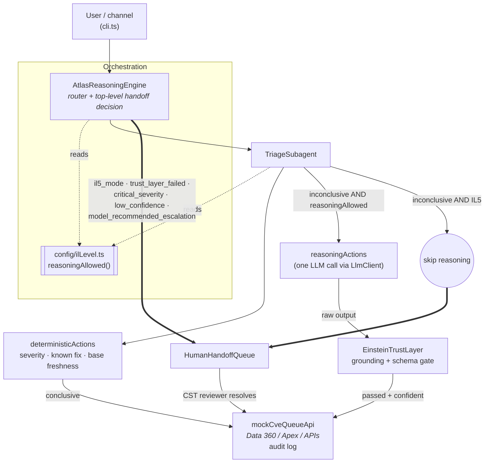

# ironbank-atlas-triage

> **⚠️ Fictional, illustrative domain model.** All findings, CVE IDs (the made-up `CVE-2099-*` range), images, and justifications in this repo are synthetic. It contains no real Iron Bank, DoD, or employer data, credentials, or proprietary details. It is an independent portfolio piece and is **not** built on, endorsed by, or affiliated with Salesforce, Agentforce, or the Department of Defense.

This repo models the **Salesforce Agentforce reference pattern** (Atlas Reasoning Engine → Subagent → deterministic and reasoning actions → Einstein Trust Layer → Data/API layer, with a human handoff path) and applies it to a real pain point in hardened-container programs like DoD Iron Bank: triaging CVE findings and the free-text justifications maintainers submit for them. Cheap, auditable rules settle most findings. One LLM call judges the rest, and every model output must clear a trust gate before it can become a decision. **The Impact Level decides whether the model runs at all.** Everything is hand-rolled TypeScript with no LangGraph or LangChain, so the control flow is readable in one sitting and matches the diagram one to one.

---

## Architecture



| Diagram node | File | Role |
|---|---|---|
| Atlas Reasoning Engine | [`src/orchestrator/AtlasReasoningEngine.ts`](src/orchestrator/AtlasReasoningEngine.ts) | Loads the finding, routes it to the subagent, and owns the single "automate or hand off?" decision |
| Subagent | [`src/subagents/TriageSubagent.ts`](src/subagents/TriageSubagent.ts) | Runs deterministic actions first. Calls reasoning only if they're inconclusive **and** the IL allows it |
| Deterministic actions | [`src/actions/deterministicActions.ts`](src/actions/deterministicActions.ts) | Pure functions, no LLM, no I/O |
| Reasoning actions | [`src/actions/reasoningActions.ts`](src/actions/reasoningActions.ts) | Builds the prompt, makes the one model call, returns **raw** text |
| Einstein Trust Layer | [`src/trust/EinsteinTrustLayer.ts`](src/trust/EinsteinTrustLayer.ts) | Schema validation and CVE grounding. Any failure forces `escalate` |
| Data 360 / Apex / APIs | [`src/data/mockCveQueueApi.ts`](src/data/mockCveQueueApi.ts), [`src/data/mockFindingsStore.ts`](src/data/mockFindingsStore.ts) | Append-only decision audit log, plus the findings source |
| Human handoff | [`src/handoff/HumanHandoffQueue.ts`](src/handoff/HumanHandoffQueue.ts) | Review queue. Resolutions are written back as `human`-sourced decisions |
| Impact Level switch | [`src/config/ilLevel.ts`](src/config/ilLevel.ts) | The **only** place that encodes what each IL permits |
| LLM provider seam | [`src/llm/LlmClient.ts`](src/llm/LlmClient.ts) | `LlmClient` interface, with a Claude implementation and an offline replay implementation |

### Decision flow for one finding

1. **Deterministic rules**, in priority order; the first conclusive rule wins:
   - `checkSeverityThreshold`: CVSS < 4.0 **and** EPSS < 0.1 → *auto-close, accepted risk*
   - `checkKnownFixAvailable`: a fix exists and the image isn't on it → *flag: patch available, rebuild*
   - `checkBaseImageFreshness`: base image rebuilt more than 90 days before the scan → *flag: stale base image*
2. **If every rule is inconclusive:**
   - **IL5** → no model call. Straight to human handoff (`il5_mode`).
   - **IL2/IL4** → the reasoning action asks the model whether the maintainer's justification actually addresses *this* CVE's risk, and requests strict JSON: `{ recommendation, confidence, rationale, referencedCveId }`.
3. **Einstein Trust Layer** gates that output. Two checks, and both must pass:
   - *Schema*: exact shape, `recommendation ∈ {accept, reject, escalate}`, `confidence ∈ [0,1]`, non-empty `rationale`, and no extra fields.
   - *Grounding*: `referencedCveId` must exactly equal the finding's CVE. A mismatch counts as a hallucination.
   - On failure the verdict is replaced with `escalate` at confidence 0. The model's original confidence is thrown away.
4. **The orchestrator decides.** It hands off to a human on the first matching reason: `il5_mode` → `trust_layer_failed` → `critical_severity` → `model_recommended_escalation` → `low_confidence` (< 0.75). Otherwise it writes the automated decision. **Every** path writes an audit entry that records the source (`deterministic` / `reasoning` / `human`), the IL, and the trust-layer result.

**Fail-closed by construction.** A model refusal, a network error, or malformed JSON all become empty or invalid output. The trust layer rejects it, and the finding goes to a human. No failure mode produces an automated decision.

---

## Why IL5 disables reasoning

> **In DoD environments, which AI models you're allowed to use depends on the Impact Level of the data. So this architecture treats "no authorized model at IL5" as a first-class routing decision, not an error. The system degrades to deterministic rules plus human review, and it does so visibly.**

Impact Levels (IL2, IL4, IL5, and up) classify how sensitive the data is, and each level has its own accreditation boundary. A model that's approved for IL2 or IL4 workloads may not be authorized for IL5 data. In this illustrative model, IL5 has *no* authorized LLM.

That constraint lives in exactly one function, `reasoningAllowed(ilLevel)` in [`config/ilLevel.ts`](src/config/ilLevel.ts). The subagent checks it as its own explicit branch, *before* any prompt is built. The model is not "called and then ignored," and the check is not a confidence threshold that happens to be unreachable. A test asserts that the mocked LLM client is called **zero** times at IL5. An invalid `IL_LEVEL` (for example `IL-5`) throws at startup instead of silently defaulting to a level that allows reasoning.

Deterministic rules still run at IL5, so low-severity and patchable findings still resolve automatically. Only the judgment calls go to people.

---

## Quickstart

Requires Node.js 22.9 or later.

```bash
npm install
npm test                       # 48 tests, all with a mocked LlmClient — no API calls

cp .env.example .env           # optional: add ANTHROPIC_API_KEY for live Claude calls
```

**No API key? It still runs.** When `ANTHROPIC_API_KEY` is unset (or `LLM_MODE=offline`), the CLI replays recorded model responses from [`mock-data/recorded-llm-responses.json`](mock-data/recorded-llm-responses.json). Two of those recordings are intentionally bad: one cites the wrong CVE and one is malformed. They show the trust layer catching bad output. With a key, the same flow calls Claude (`claude-opus-5` by default, overridable with `ANTHROPIC_MODEL`) using structured JSON output.

### The demo: same findings, two Impact Levels

```bash
IL_LEVEL=IL4 npm run cli -- triage-all
IL_LEVEL=IL5 npm run cli -- triage-all
```

Offline replay output (abridged):

```text
Impact Level: IL4   LLM reasoning: enabled (replay:recorded-responses)

Summary (18 findings, 10 LLM calls)
Auto-resolved — deterministic                   7
Auto-resolved — reasoning (trust layer passed)  5
Escalated — forced by trust layer               2
Human handoff — total                           6
  └ critical_severity                           2
  └ model_recommended_escalation                1
  └ low_confidence                              1
  └ trust_layer_failed                          2
```

```text
Impact Level: IL5   LLM reasoning: DISABLED — not authorized at this Impact Level

Summary (18 findings, 0 LLM calls)
Auto-resolved — deterministic                   7
Auto-resolved — reasoning (trust layer passed)  0
Escalated — forced by trust layer               0
Human handoff — total                           11
  └ critical_severity                           1
  └ il5_mode                                    10
```

### Other commands

```bash
npm run cli -- triage F-013        # full decision path for one finding (F-013 = hallucinated CVE, caught by the trust layer)
npm run cli -- queue               # pending human-handoff items (--all to include resolved)
npm run cli -- resolve F-012 reject --note "Regex input path not addressed"   # simulate a CST reviewer
npm run cli -- audit-log           # every decision: source, IL, trust-layer result
npm run cli -- reset               # clear local state
```

`triage-all` starts a fresh batch each time. State is kept in `.state/` (gitignored) so that `queue`, `resolve`, and `audit-log` work across separate CLI runs.

Example `triage F-013` trace:

```text
F-013  CVE-2099-10013  High  libssh2 1.10.0  demo-registry.local/hardened/ansible-ee:2.16
Decision path:
   1. AtlasReasoningEngine  Loaded F-013 (CVE-2099-10013, High, libssh2) at IL4. Routing to TriageSubagent.
   2. deterministicActions  severity_threshold: no — Above low-severity floor (CVSS 7.4, EPSS 0.19).
   3. deterministicActions  known_fix_available: no — No upstream fix for libssh2.
   4. deterministicActions  base_image_freshness: no — Base image fresh (36 days old).
   5. TriageSubagent        Deterministic actions inconclusive.
   6. reasoningActions      Reviewing submitted justification via replay:recorded-responses.
   7. EinsteinTrustLayer    FAILED — grounding mismatch: model referenced "CVE-2099-31337" but finding is "CVE-2099-10013". Forcing escalation.
   8. AtlasReasoningEngine  Handoff required: trust_layer_failed.
   9. HumanHandoffQueue     Enqueued F-013 for CST review.
  10. mockCveQueueApi       Audit entry written: pending_human_review.
Result: HUMAN HANDOFF (trust_layer_failed)
```

---

## Design notes

- **Why no LangGraph?** Agentforce isn't built on it, and a hand-rolled state machine makes the routing rules explicit. `determineHandoffReason()` is one pure function you can read top to bottom.
- **The subagent never writes decisions.** It returns a typed `SubagentResult` (`deterministic` | `reasoning` | `reasoning_not_permitted`), and only the orchestrator writes or hands off. That keeps the routing policy in one place.
- **Reasoning actions never parse model output.** Raw text goes straight to the trust layer, so the gate can't be bypassed by a "helpful" parse upstream. The trust layer re-validates even when the provider enforces a JSON schema natively. Defense in depth is also what keeps `LlmClient` swappable.
- **Critical findings always get human eyes,** even when a deterministic rule or a confident model has a clean answer. The automated conclusion is attached to the queue item as reviewer context.
- **Time-based rules use the scan's `snapshotDate`,** not the wall clock, so the demo output is reproducible.
- **`model_recommended_escalation`** was added alongside the four core handoff reasons, so that "the model asked for a human" is recorded distinctly from "the model was unsure."

## Tests

| File | Covers |
|---|---|
| `deterministicActions.test.ts` | Each rule fires on crafted inputs, including strict threshold boundaries, the exact-90-day boundary, and fall-through when inconclusive |
| `reasoningActions.test.ts` | Prompt contents, a single LLM call with the schema, raw passthrough, and transport failure turning into empty output |
| `EinsteinTrustLayer.test.ts` | Mismatched CVE fails grounding. Ten malformed-output shapes fail schema validation. All of them force escalation |
| `ilLevel.test.ts` | Env parsing and rejecting invalid levels. **At IL5 the LLM spy records zero calls** and every inconclusive finding is handed off as `il5_mode`. Deterministic rules still resolve |
| `AtlasReasoningEngine.test.ts` | End-to-end happy paths (deterministic and reasoning), every escalation path, reviewer resolution, and the bundled dataset at IL4 vs IL5 |

The LLM client is mocked in every test. The suite makes no network calls.

## Non-goals

- **No real Salesforce APIs.** No Apex, no Agentforce, no Data Cloud. The "Einstein Trust Layer" and "Data 360" here are illustrative stand-ins named for the pattern they mirror.
- **No VEX handling.** No OpenVEX or CSAF ingestion or emission.
- **No real CVE data.** All IDs are in the fictional `CVE-2099-*` range, and no vulnerability feeds are queried.
- **Not a production system.** No auth, no multi-user concurrency, no real accreditation logic. The IL model is deliberately simplified to one switch.

## License

MIT
